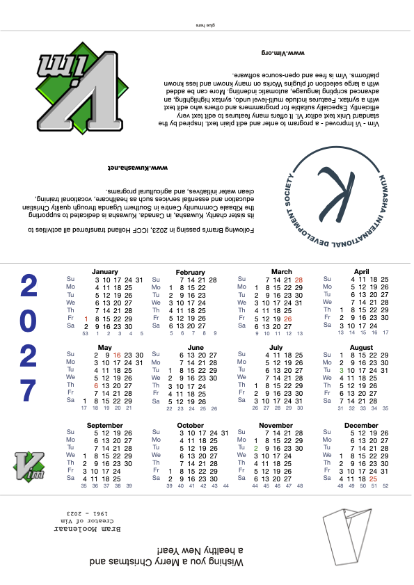
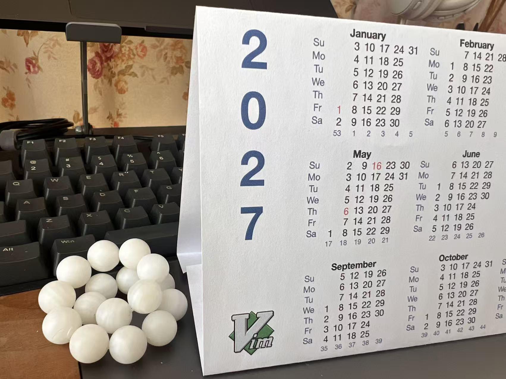

# Vim desktop Calendar

> for Bram Moolenaar （米勒） https://moolenaar.net/#Calendar

A desktop calendar for 2027, made from one sheet of paper. 
After folding, one side contains a useful 12-month calendar. 
On the other side there is brief information about (<del>ICCF-Holland</del>) Kuwasha, 
and Vim. All files are PDF format, about 310 Kbyte.

**language - paper size** 
[English - A4](https://raw.githubusercontent.com/hotoo/vim-desktop-calendar/main/files/2027_en_a4.pdf) 
[English - Letter](https://raw.githubusercontent.com/hotoo/vim-desktop-calendar/main/files/2027_en_le.pdf) 
[Dutch - A4](https://raw.githubusercontent.com/hotoo/vim-desktop-calendar/main/files/2027_nl_a4.pdf) 
[German - A4](https://raw.githubusercontent.com/hotoo/vim-desktop-calendar/main/files/2027_de_a4.pdf) 

 

## 

 

More showcase see [#1](https://github.com/hotoo/vim-desktop-calendar/issues/1) please.

##

[About calendar colors](https://github.com/hotoo/vim-desktop-calendar/wiki)
